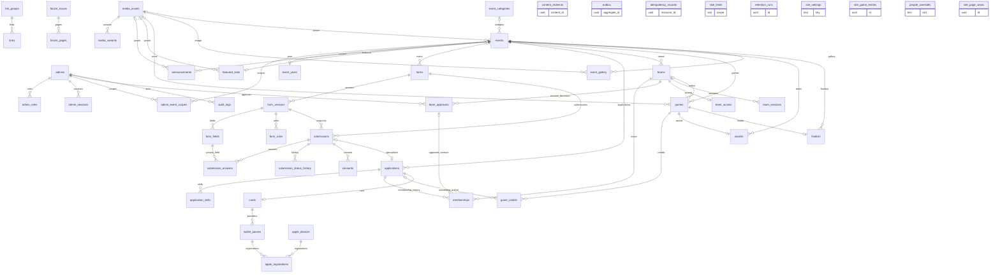

# Güncel ER ve Tablo Envanteri

Güncelleme: Kasım 2026 (v0.2 Final Sürümü). PostgreSQL 17 / Drizzle ORM omurgası üzerinde toplam 48 tablo tanımlıdır. 

---

## Modüler Tablo Listesi

1. **Yönetim ve Güvenlik (Admin & Auth):** `admins`, `admin_roles`, `admin_sessions`, `admin_event_scopes`, `audit_logs`
2. **Etkinlik ve İçerik (Events & Content):** `events`, `event_categories`, `event_years`, `announcements`, `featured_slots`, `event_gallery`, `content_redirects`
3. **Medya (Media Engine):** `media_assets`, `media_variants`
4. **Form ve Başvurular (Forms & Submissions):** `forms`, `form_versions`, `form_fields`, `form_rules`, `submissions`, `submission_answers`, `submission_status_history`, `consents`
5. **UluJam ve Eşleştirme (Jam & Teams):** `applications`, `application_skills`, `teams`, `memberships`, `team_approvals`, `team_access`, `team_sessions`
6. **Oyun Kataloğu ve Dereceler (Games & Awards):** `games`, `game_credits`, `awards`, `finalists`, `site_game_entries`
7. **Kart ve Dijital Cüzdan (Cards & Wallet):** `cards`, `wallet_passes`, `apple_devices`, `apple_registrations`
8. **Link Merkezi (Link Hub):** `link_groups`, `links`
9. **Fanzin Modülü (Fanzin & Flipbook):** `fanzin_issues`, `fanzin_pages`
10. **CMS ve Dinamik Ayarlar (Site Settings & People):** `site_settings`, `people_overrides`
11. **Analitik (Analytics Engine):** `site_page_views`
12. **Altyapı ve Kuyruk (Operations & Infrastructure):** `outbox`, `idempotency_records`, `rate_limits`, `retention_runs`

---

## Güvenlik ve İzolasyon Standartları

- **Server-Only Sınırı:** Veritabanı sorguları ve şema importları kesinlikle `"server-only"` modülü altında tutulur. İstemci bileşenlerine asla doğrudan erişim verilmez.
- **Bileşik Dış Anahtarlar (Composite Foreign Keys):** Form/etkinlik, başvuru/sürüm, cevap/alan ve takım/etkinlik bileşik anahtarları veri sızıntısını ve çapraz erişimi veritabanı seviyesinde engeller.
- **İdempotency ve Outbox:** Tüm dış servis bildirimleri (e-posta, Google Wallet pass oluşturma) transaction içi outbox tablosu ve idempotency kontrolleriyle asenkron worker tarafından güvenle işlenir.
